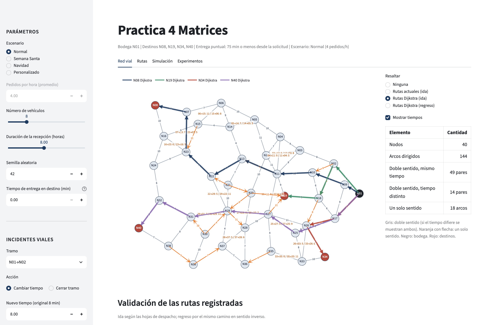

# Práctica 4 — Logística del Valle

**CC2017 Modelación y Simulación · Ciclo 2, 2026 · Jorge Palacios (231385)**

Aplicación en Streamlit y simulación de eventos discretos para evaluar las rutas de reparto (bodega `N01`, destinos `N08`, `N19`, `N34`, `N40`) y el tamaño de la flota de Logística del Valle.

- **App desplegada:** https://practica-4-simulacion-y-modelacion-36hsrtcitmgsq6xu8c7pmz.streamlit.app/



## Estructura

```
├── app.py                 # Aplicación Streamlit
├── experimentos.py        # Experimentos reproducibles → resultados/ y figuras/
├── requirements.txt
├── data/matriz.csv        # Anexo A: matriz de adyacencia (minutos)
├── src/
│   ├── grafo.py           # Grafo dirigido y validación de rutas
│   ├── algoritmos.py      # Dijkstra, A*, Bellman-Ford, Yen, desvíos
│   ├── simulacion.py      # Simulación de eventos discretos y métricas
│   └── visual.py          # Gráficas Plotly
├── resultados/            # CSV de los experimentos
├── figuras/               # Figuras del informe
└── screenshots/           # Capturas de la app
```

## Ejecución local

```bash
python -m venv .venv && source .venv/bin/activate
pip install -r requirements.txt
streamlit run app.py          # http://localhost:8501
python experimentos.py        # regenera resultados/ y figuras/
```

## La aplicación

- **Red vial:** grafo interactivo con sentidos de circulación, tiempos y rutas resaltadas; validación de las rutas registradas.
- **Rutas:** comparación de Dijkstra, A\* y Bellman-Ford; ruta actual frente a las alternativas por destino (ida y regreso por separado).
- **Simulación:** ambas políticas con los mismos pedidos; indicadores, cola, ocupación de vehículos.
- **Experimentos:** repeticiones pareadas por escenario y barrido del tamaño de la flota.
- **Barra lateral:** escenario (normal, Semana Santa, Navidad o personalizado), pedidos por hora, vehículos, duración de la recepción, semilla e incidentes viales (cambiar el tiempo de un tramo o cerrarlo). Las rutas se recalculan automáticamente.

## Despliegue (Streamlit Community Cloud)

1. Subir el repositorio a GitHub.
2. En [share.streamlit.io](https://share.streamlit.io) → **Create app** → repositorio, rama `main`, archivo `app.py`.
